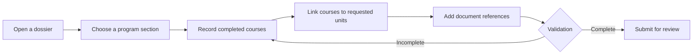
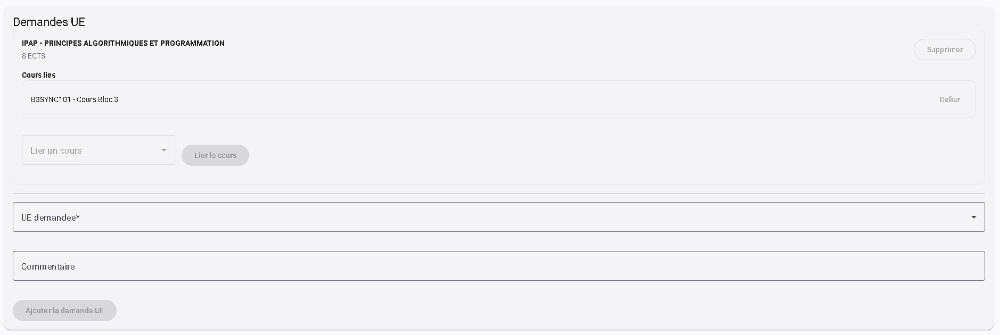

# Academic Exemption Management

ISFCE project that helps students request an exemption based on prior coursework. The submitted application uses Angular, a Spring Boot REST API, H2 and Keycloak. The source repository includes the backend, frontend, tests and PlantUML workflow diagrams. [Application source and local setup](https://github.com/safouanfr-arch/academic-exemption-platform)

## Student workflow

Students can resume a draft, link completed courses to requested teaching units, and upload supporting files or add references. The application shows validation feedback before submission and displays the status of each dossier on the dashboard.

A unit request can refer to several completed courses. Each completed course can support one unit request within a dossier. Dossier state controls whether students can still edit those links.

## Workflow screenshots

