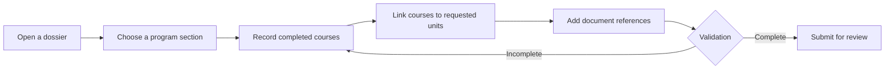
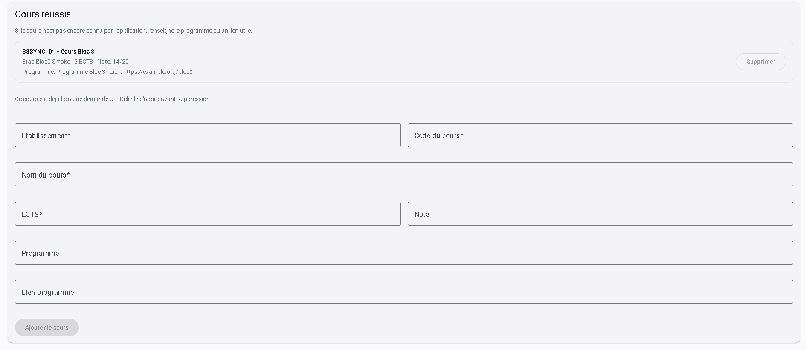
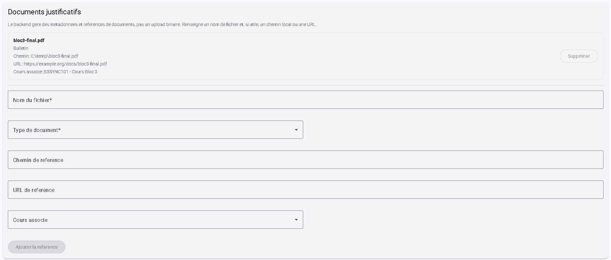

# Academic Exemption Management

ISFCE application design for supporting a request to waive a teaching unit based on prior coursework. The project documents how a student prepares a dossier, links previous courses to the requested units and supplies references for reviewers.

## What the materials show

- The archived starting application uses Angular, a Spring Boot REST API, H2 and Keycloak. It covers sign-in, the unit catalogue and opening a dossier.
- The project screenshots show a later workflow with course-to-unit links, document references and submission checks. The final source for these screens was not in the recovered code folder, so this page presents the design and screenshots instead of distributing the classroom codebase.
- The documents screen records file references and metadata. It describes reference entry rather than file uploads.

A unit request can refer to several completed courses. A junction entity keeps that relationship separate from the individual course details, so the same course can support more than one request. Dossier state controls whether students can still edit those links.

## Prototype screens

