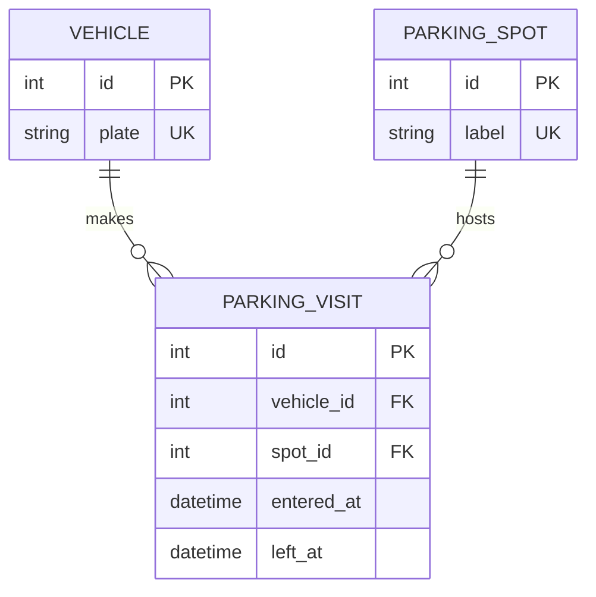
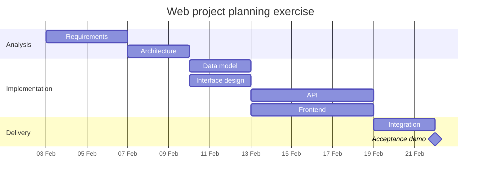

# Data Modelling and Project Planning

Selected examples based on the ISFCE work in Merise, Looping and GanttProject. The diagrams use generic labels and synthetic data.

## Conceptual to relational model

The parking model links a vehicle and a spot through a visit. Making the visit its own entity stores timestamps and preserves the history after a spot is freed.

The [Firebird lab](../sql/) implements this model. The [exemption case study](../exemptions/) applies similar modelling to dossiers, units and course equivalences.

## Planning dependencies

The coursework schedule broke a web project into requirements, architecture, database and UI design, development and integration. This simplified schedule uses relative phases from that work.

