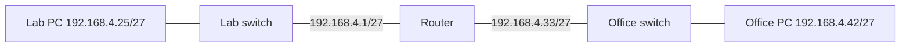

# Networking Labs

The IPv4 addressing assignment compared network and broadcast addresses, usable host counts and subnet masks. The calculator uses the standard Python `ipaddress` module and runs offline.

```sh
python3 networking/subnets.py 192.168.4.25/24 192.168.4.25/25 192.168.4.25/29
python3 networking/subnets.py 192.168.4.25/22 192.168.4.25/27
```

## Packet Tracer practice topology

This diagram is a reproducible practice scenario derived from the subnetting exercises. It uses sample addresses and can be built in Packet Tracer.



1. Place two PCs, two switches and a router in a new simulation.
2. Assign the addresses shown and use the router interface in each subnet as its default gateway.
3. Check that each PC can reach its gateway, then ping the other PC in the simulator.
4. Compare the route between the PCs with a packet confined to either subnet.
